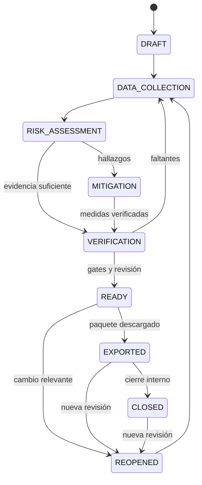

# Riesgo, legalidad y debida diligencia

FUENTE: S1 §§33–44, 82–85; S3 §§20–23, 35–39. PROPUESTA de ingeniería, no dictamen legal. Las guías nacionales referidas no se recibieron completas; validar requisitos aplicables contra fuente primaria vigente.

## Dimensiones separadas

| Dimensión | Valores propuestos | Interpretación |
| --- | --- | --- |
| Severidad | NOT_ASSESSED, LOW, MEDIUM, HIGH, CRITICAL | Resultado técnico explicable |
| Proceso de revisión | OPEN, UNDER_REVIEW, MITIGATION_REQUIRED, RESOLVED | Trabajo pendiente |
| Conclusión regulatoria | UNDETERMINED, NEGLIGIBLE, NON_NEGLIGIBLE | Solo bajo perfil jurídico y revisión autorizados |
| Readiness | BLOCKED, IN_PROGRESS, READY, STALE | Preparación de snapshot |

`LOW` no implica riesgo jurídicamente insignificante. `RESOLVED` puede significar que se investigó y rechazó el material, no que se volvió elegible. Score insuficiente es null/NOT_ASSESSED y genera acción de recopilación, no cero.

## Categorías

DEFORESTATION, LEGALITY, MIXING, SUPPLY_CHAIN, DOCUMENT_CREDIBILITY, TRACEABILITY, EVASION, HUMAN_RIGHTS, INDIGENOUS_RIGHTS y DATA_QUALITY. Cada factor conserva valor, método, peso si aplica, severidad, explicación, fuentes y acción sugerida.

## Registro de regla

`code`, categoría, condición tipada, inputs requeridos, severidad/acción, explicación, evidencia requerida, fuente normativa/metodológica, rule_set_version, vigencia, jurisdicción/producto, estado de aprobación y aprobador. Condiciones configurables seguras y deterministas; evitar ejecutar código arbitrario almacenado como regla.

| Regla ejemplo | Efecto técnico | Límite |
| --- | --- | --- |
| DATA_MISSING_ORIGIN | Bloqueo de origen y tarea de completar | No inventar parcela |
| GEOMETRY_INVALID | Bloqueo de análisis fiable | Mantener borrador y reparación revisada |
| SATELLITE_COVERAGE_UNKNOWN | NOT_ASSESSED y revisión requerida | Sin alertas no prueba ausencia de deforestación |
| DOCUMENT_EXPIRED | Evidencia no vigente para periodo indicado | Comprobar alcance temporal |
| MASS_BALANCE_INCONSISTENT | Bloqueo de consumo/despacho | Corrección auditada |
| MATERIAL_OF_UNKNOWN_ORIGIN | Bloqueo según perfil aplicable | Un saldo positivo no autoriza mezcla |
| MITIGATION_UNVERIFIED | Bloqueo de cierre de revisión | Verificar con revisor autorizado |

No se aprueban pesos, umbrales ni lista jurídica definitiva en este paquete. Probar que sumar factores y limitar un score no oculta un factor crítico; bloqueos se evalúan independientemente del promedio.

## Mecanismos D-07 adoptados para el MVP local (2026-10-15)

**Mecanismos primero, catálogo después.** Primero se adoptó **cómo** se aprueban y clasifican las reglas
(migración `0042`); después se publicó el catálogo técnico **`1.0.0`** (migración `0043`). `0.1.0` y `0.2.0`
siguen `NOT_APPROVED`, sin severidades y sin adopción: no se migró ni se recalculó nada.

**Aprobación en TRES actos distintos (D-07.1 y D-07.5).** Las definiciones son globales, así que se separan:

| Acto | Dónde | Quién | Hoy |
| --- | --- | --- | --- |
| **Publicación global** | `risk_rule_sets.approval_status` | Acto de migración. **Nadie publica reglas desde la API** | `1.0.0` = `APPROVED` |
| **Adopción de uso por organización** | `risk_rule_set_adoptions`, append-only | Usuario con `risk:approve_rules` (hoy solo `ORG_ADMIN`), con fecha, motivo y auditoría | Ninguna organización la ha adoptado |
| **Aprobación bajo perfil jurídico** | `risk_rule_sets.regulatory_profile` | **D-07.5, pendiente** | `NULL` en todas las versiones |

Los tres hacen cosas distintas: publicar dice que la versión existe y que el proyecto la respalda; adoptar es lo
que habilita **clasificar hallazgos** en una organización; aprobar bajo perfil jurídico sería lo que permitiría
**concluir**, y no ha ocurrido. Por eso el requisito `RISK_CATALOG_APPROVED` del expediente sigue `NOT_EVALUABLE`
aunque el catálogo esté publicado y aunque una organización lo adopte: **publicar un catálogo técnico no abre
`READY`**.

Una adopción en una organización **no aprueba reglas en otra**, y no se puede adoptar una versión que el proyecto
no haya publicado. **No se amplía `SUPER_ADMIN` ni se resuelve D-04**: el permiso es de ámbito de organización.

**Severidad (D-07.2).** Declarada **por regla y por versión**; la del sujeto es el **máximo** de los hallazgos
evaluados. Sin promedio, sin suma y sin score: **D-07.3 no aplica** y el modelo no admite pesos ni cortes.

- Solo cuentan los `HIT`. Un `NOT_EVALUABLE` **no aporta**: no se sabe qué habría dado.
- **A.2**: sin hallazgos, `NOT_ASSESSED`. **No se asigna «bajo» por ausencia** — evaluar todas las reglas
  publicadas no demuestra cobertura completa mientras cuatro categorías no tengan ninguna regla.
- Un `HIT` cuya regla no declara severidad **no clasifica**, y se dice cuál.
- **Sin adopción no hay severidad**, y el `CHECK` lo impide estructuralmente.
- La severidad **viaja siempre con su cobertura**: reglas evaluadas, no evaluables, hallazgos sin severidad
  declarada y categorías sin reglas. Una clasificación **parcial se declara parcial**; un hallazgo conocido **no
  desaparece** porque otra regla no se pudiera evaluar.
- **No sustituye al resultado técnico.** La precedencia sigue mandando, y un bloqueante no se diluye.

**Vigencia (D-07.4).** Una evaluación queda `STALE` cuando cambian los datos de su instantánea o la versión de
reglas, **sin modificarse**. Reevaluar **crea un registro nuevo**; los anteriores quedan intactos con su severidad
y su versión. Se conservan las caducidades documentales existentes y **no se inventan plazos generales**.

**Lo que sigue bloqueado.** La **conclusión regulatoria** sigue `UNDETERMINED` por `CHECK`: **D-07.5** (perfil
jurídico) y **D-07.6** (quién concluye: mecanismo implementado el 2026-10-22, `risk:conclude` para `EUDR_MANAGER`; su aceptación regulatoria real sigue pendiente) ya no bloquea el mecanismo. Nada de esto habilita `READY` ni despacho.

### Catálogo `1.0.0` (publicado el 2026-10-15, migración `0043`)

Ocho reglas; **cinco con severidad declarada y tres sin ella**. La versión es **inmutable**: cambiar una severidad
es publicar otra versión, no editar esta.

| Regla | Categoría | Efecto | Severidad |
| --- | --- | --- | --- |
| `MATERIAL_OF_UNKNOWN_ORIGIN` | MIXING | BLOCKING | **CRITICAL** |
| `MASS_BALANCE_INCONSISTENT` | TRACEABILITY | BLOCKING | **CRITICAL** |
| `DATA_MISSING_ORIGIN` | TRACEABILITY | BLOCKING | **HIGH** |
| `GEOMETRY_INVALID` | GEOLOCATION | BLOCKING | **HIGH** |
| `DOCUMENT_EXPIRED` | DOCUMENTATION | REVIEW_REQUIRED | **MEDIUM** |
| `MITIGATION_UNVERIFIED` | MITIGATION | BLOCKING | — (sin declarar) |
| `SATELLITE_COVERAGE_UNKNOWN` | DEFORESTATION | NOT_ASSESSED | — (sin declarar) |
| `GEOLOCATION_PROFILE` | GEOLOCATION | NOT_ASSESSED | — (sin declarar) |

**Las cinco severidades son DECISIONES DE PRODUCTO.** Las fuentes sostienen el **hecho** (qué datos exige el
Reglamento, qué significa un origen incompleto) y el **límite** (qué no se puede afirmar), pero **ninguna fuente
gradúa** el riesgo en crítico/alto/medio: esa graduación la decide Terra Link y así se declara en el campo
`source` de cada regla y en las notas de la versión.

`MATERIAL_OF_UNKNOWN_ORIGIN` se describe por su **condición real**: algún lote del grafo de origen tiene el origen
`INCOMPLETE`. Eso **no** es una mezcla ilegal, un fraude ni una irregularidad probada; el origen puede completarse.

**Cobertura declarada incompleta:** `LEGALITY`, `EVASION`, `HUMAN_RIGHTS` e `INDIGENOUS_RIGHTS` siguen **sin
ninguna regla**. Una clasificación de este catálogo nunca es una evaluación completa del riesgo del lote.

Matriz completa y razonamiento: `docs/decisiones/D-07-MATRIZ-CATALOGO.md`. Contrato de mecanismos:
`docs/decisiones/D-07-PROPUESTA.md`.

## Evaluación reproducible

Fijar sujeto y alcance → snapshot de productores/parcelas/entregas/lotes → seleccionar reglas aprobadas → resolver evidencias/versiones/cobertura → calcular factores y resultado → almacenar hash/versión/explicación → crear tareas → revisión autorizada. Reevaluación crea nueva evaluación enlazada a anterior, no UPDATE destructivo.

Cambios en geometría, evidencia, origen, regla o cantidad marcan readiness dependiente como STALE y generan trabajo deduplicado. Un job atrasado no sobreescribe una evaluación posterior: comprobar versión objetivo.

## Legalidad Ecuador

Convertir requisito → aplicabilidad → soporte requerido → validación → riesgo → acción. Registrar temas de tenencia, uso de suelo, derechos laborales/humanos/indígenas y requisitos operativos cuando el revisor confirme pertinencia. Un título documental no prueba por sí solo vigencia ni legalidad. El perfil debe indicar autoridad, artículo/fuente, versión, fechas y responsable. Certificaciones aportan soporte cuando sea aplicable y no sustituyen diligencia.

## Mitigación

Crear acción con causa, responsable, fecha, evidencia requerida y criterio de aceptación. Aportar soporte → revisión → VERIFIED o REJECTED con motivo. Cierre de tarea no cambia la regla sin evaluación; reevaluar después de verificar. Conservar actor ejecutor/verificador; excepción de autoaprobación requiere política expresa y auditoría.

## Ciclo del expediente

Esta máquina es la propuesta de S1 ampliada; mapear a estados reales (p. ej., DDS simplificado) sin romper flujos ya implementados. Transiciones vía casos de uso autorizados, con guards. `READY` requiere todos los requisitos aplicables, trazabilidad y cantidades consistentes, evidencia vigente, riesgo revisado y mitigaciones aceptadas. Porcentaje alto no elimina bloqueo.

## Paquete

Operador y rol aplicable, producto/identificación, cantidades/unidades, país, periodo, proveedores/comprador según alcance, actores, lista completa de orígenes y geometrías, evidencia ambiental/legal, evaluación, mitigaciones, verificación y audit trail. Manifest de versiones, hashes, fecha y responsable. Generar paquete desde snapshot aprobado, no leyendo tablas mutables durante la descarga.

## Presentación oficial: dimensión independiente

Paquete interno descargado no es DDS presentada. Propuesta de submission: `NOT_SUBMITTED → SUBMITTING → ACCEPTED / REJECTED / UNKNOWN`; guardar entorno, recibo/referencia auténticos y operador. Timeout = UNKNOWN, consultar/reconciliar antes de reenviar para evitar duplicados. Producción requiere autorización específica.

La Comisión distingue ACCEPTANCE (ensayo sin valor legal) de PRODUCTION (presentaciones con valor legal), publica documentación de API y formato GeoJSON. No se presupone acceso, contrato ni compatibilidad desde este paquete. El rol económico aplicable se determina por operación/cadena y norma vigente; no deducir que todo exportador ecuatoriano presenta DDS por tener rol EXPORT_MANAGER.

Fuentes oficiales consultadas el 9 de octubre de 2026: [Information System](https://green-forum.ec.europa.eu/nature-and-biodiversity/deforestation-regulation-implementation/information-system-deforestation-regulation_en) y [implementación EUDR](https://green-forum.ec.europa.eu/nature-and-biodiversity/deforestation-regulation-implementation_en). Revisar versiones y normativa consolidada antes de activar fechas, umbrales, plazos, categorías de país o obligación específica.

## Implementación P0-020 (2026-10-10)

Catálogo `risk_rule_sets`/`risk_rules` 0.1.0 (**NO APROBADO**) con las reglas ejemplo de este documento más `GEOLOCATION_PROFILE` (**depende de D-05.B**, la aplicabilidad jurídica; el perfil **técnico** D-05.A ya está adoptado y no basta: cumplir el perfil no es conformidad). Sujeto: lote y su grafo de origen. Por factor: HIT / NOT_HIT / NOT_EVALUABLE; efecto BLOCKING / REVIEW_REQUIRED / NOT_ASSESSED tomado de la columna «efecto técnico». Resultado técnico por precedencia (BLOCKED > REVIEW_REQUIRED > INCOMPLETE > sin hallazgos en lo evaluado); severidad NOT_ASSESSED y conclusión UNDETERMINED fijadas en base hasta un perfil aprobado. Evaluaciones append-only con instantánea y hash; STALE cuando cambia la instantánea o la versión de reglas. Readiness, mitigación y expediente no se implementan (P0-021/P0-022).

## Implementación P0-021 (2026-10-10)

Mitigación = acción (evaluación, factor, lote, criterio, evidencia requerida, responsable, plazo) → soportes por versión exacta → entrega → VERIFIED/REJECTED con motivo por un verificador distinto del ejecutor (sin excepción). `MitigationVerified` dispara por outbox una reevaluación (con el catálogo que le aplique a la organización) que recalcula todas las reglas; `MITIGATION_UNVERIFIED` bloquea el cierre de la revisión. No hay criterios legales ni acciones correctivas predefinidas; el criterio concreto lo documenta quien crea la acción.

## Implementación P0-022 (2026-10-10)

Mapeo del ciclo propuesto a estados reales: expediente por lote → instantáneas inmutables con readiness `BLOCKED` / `IN_PROGRESS` / `READY` (y `STALE` calculado al comparar con los datos actuales) → revisión `OPEN` / `UNDER_REVIEW` / `RETURNED` / `APPROVED` → exportaciones `INTERNAL_REVIEW` (borrador) o `DD_PACKAGE` (exige aprobación vigente). Presentación oficial: siempre `NOT_SUBMITTED` (no implementada). Requisitos dependientes de perfil jurídico, D-05, satélite, catálogo aprobado o embarques quedan NO EVALUABLES y bloquean READY; no se inventó perfil ni se rebajaron requisitos.

## Revisión P0-021 (2026-10-10): soporte, acción y causa

Verificar exige declarar que se cumple el criterio de aceptación (`criterion_met`). La vista separa: soporte aceptado ·
acción ejecutada (criterio) · causa (resultado del factor en la última evaluación). Si una acción verificada conserva la
causa, se avisa y un verificador distinto del ejecutor puede **corregir** la verificación: la decisión original se
conserva, la acción queda `REOPENED` para otra entrega y se encola una reevaluación. La evaluación registra quién la
desencadenó, que la ejecutó el worker de reevaluación y si hubo revisión humana. P0-022: el paquete final se bloquea si
exigiría redactar contenido por alcance (`EXPORT_SCOPE_INSUFFICIENT`); todo paquete declara como pendientes la inclusión
de archivos y los campos del perfil destino.

## Orientación, soporte, comprobación técnica y revisión humana (precisión de 2026-10-23)

Cuatro cosas distintas que la interfaz no debe confundir (plan de ajuste `contexto/PLAN_AJUSTE_MINIMO_DOCUMENTACION_Y_PRODUCTO_2026-10-23.md`; Documentación Técnica Maestra §§30–32, 41–44, 85 y Arquitectura módulos 07 y 10):
1. **Orientación** (biblioteca y guías, con fuente y fecha): explica qué aspectos se podrían documentar; **no prueba** la situación de una parcela ni es una lista obligatoria uniforme. No es paso previo para subir un archivo.
2. **Soporte aportado** por el actor, vinculado a su entidad (productor, parcela y, mediante `delivery_supports`, entrega): tipo, titular, autor de carga, fecha, versión y emisión/vencimiento solo si el documento los tiene.
3. **Comprobación técnica**: formato, tamaño, análisis antimalware, integridad (hash), acceso y vínculos. «Sin detecciones» no significa auténtico; el hash identifica una versión y detecta cambios, no certifica su contenido.
4. **Revisión y decisión humanas**, con persona, fecha, objeto revisado y motivo. «Revisado por una persona» no es una certificación de Terra Link. La revisión de un perfil global y la revisión de un documento de una finca son objetos distintos.

Cargar un archivo **no** marca ningún requisito como MET, no relaja READY, despacho ni traspasos, y no depende de la revisión de ningún perfil global. Implementado en `qa/EVIDENCIA_A05_MI_FINCA_DOCUMENTOS_2026-10-23.md` y `qa/EVIDENCIA_AJ_ENTREGA2_2026-10-23.md`.

## Matriz de información y soportes del expediente (2026-10-30)

Qué información pide el expediente, de dónde sale en Terra Link, quién la aporta, con qué soporte exacto, quién la ve y si entra en la instantánea. Contrastada con el código (`apps/api/src/dd/dd.ts`, `requirements.ts`, `authz/access-grants.ts`) y con las guías aportadas por el propietario (`contexto/…`, **recomendaciones y no requisitos originales**). Antes de atribuir una obligación jurídica concreta hay que comprobar su aplicabilidad y la fuente vigente: esta matriz **no** fija obligaciones uniformes por tipo de documento ni sustituye una revisión jurídica.

| Información | Origen en Terra Link | Quién la aporta | Soporte exacto (versión · huella) | Visibilidad | Uso en riesgo | En la instantánea | Faltante conocido |
| --- | --- | --- | --- | --- | --- | --- | --- |
| Producto, cantidades y unidades | Producto, entrega, recepción, lote y libro (`quantities`) | Operación (acopio, recepción) y trazabilidad | Registros del libro; la recepción deja peso declarado/recibido | Interno por rol; el destinatario ve estado y agregados | `SUBJECT_QUANTITY`, `QUANTITIES_CONSISTENT` | Sí (`subject`, `quantities`, `origin`) | — |
| País de producción | `organizations.country` y ubicación de parcela (provincia, cantón, parroquia) | La organización y quien registra la parcela | Sin documento propio | Interno | Ninguno | **No hay campo propio de «país de producción» en el contenido** | **Carencia explícita**: no se infiere del país de la organización; depende del perfil de destino |
| Periodo de producción | Cosecha declarada en la entrega (`harvest_*`, con precisión) | Quien declara la entrega (productor/técnico/acopio) | Sin documento propio | El destinatario lo ve en la vista compartida de un lote | `ORIGIN_DECLARED` (origen), no el periodo | **No** forma parte del contenido de la instantánea | **Carencia explícita**: la fecha de entrega no sustituye la cosecha; sin declaración es «desconocido» |
| Parcelas, polígonos y versiones | Captura web/móvil, importación, versiones geométricas | Productor, técnico asignado, administración | Versión geométrica · `geometry_hash` · método de captura | Coordenadas solo con `plot:read_geometry`; **nunca** por concesión | `GEOMETRY_TECHNICAL`, `GEOLOCATION_PROFILE` | Sí (`plots`, con geometría redactable) | Perfil de geolocalización sin revisión jurídica (externo) |
| Proveedores, destinatarios y función de cada actor | Organizaciones, vínculos, traspasos, embarques | Responsable de la operación | Hecho declarado; sin documento | Interno; destino del embarque «declarado, no verificado» | Ninguno | Parcial (`shipment_links`) | La categoría jurídica del actor no la decide el rol de la app |
| Legalidad y soportes | Guía orientativa + documentos vinculados (`delivery_supports`, evidencias, soportes de mitigación) | Quien aporta (productor, técnico, acopio) y quien revisa el objeto correspondiente | **Versión del documento · SHA-256 · escaneo** | Interno por alcance; **destinatario: solo con «Compartir soportes»**, versiones exactas, sin datos personales | `DELIVERY_SUPPORTS`, `LEGAL_PROFILE`, evidencias | Sí (`documents`, por versión y huella; los archivos no se incrustan en el JSON) | Perfil jurídico sin revisión (externo); los tipos exigibles dependen de los hechos de cada finca |
| Deforestación | Análisis por versión de parcela (propietaria o exportadora autorizada) | Exportadora/EUDR dentro de su autorización | Resultado guardado · versión y huella geométricas · original con SHA-256 | Interno; entre organizaciones solo por la autorización de la parcela | `DEFORESTATION_ANALYSIS` (recibido ≠ satisfecho) | Sí (`profiles.satellite_analysis`) | Proveedor sin selección permanente (D-09 B); cobertura `UNKNOWN` |
| Riesgo, evidencia y mitigaciones | Evaluaciones versionadas, hallazgos, evidencias y acciones | EUDR_MANAGER y roles con separación de funciones | Evaluación (hash del contenido, versión de reglas) · soportes de mitigación (versión y huella) | Interno; el destinatario ve estados | `RISK_*` | Sí (`risk`, `evidence`, `mitigations`) | Catálogo y conclusión humana (D-07, externo) |
| Identificadores y campos del destino oficial | Contrato del perfil de destino (EUDR-IS/TRACES) | Organización operadora, con su acceso al destino | — | — | — | **No implementado** (`DESTINATION_PROFILE_FIELDS`, `NOT_SUBMITTED`) | Canal, autorización, entorno y respuesta auténticos: terceros |

### Seis cosas que no se confunden

1. **Documento aportado:** un archivo con su versión y huella, vinculado a su titular. Aportarlo no lo aprueba ni marca ningún requisito.
2. **Comprobación técnica y revisión humana:** formato, tamaño, antimalware e integridad son controles técnicos («sin detecciones» no es «auténtico»); la revisión humana registra persona, fecha, objeto y motivo, y no es una certificación de Terra Link.
3. **Análisis satelital y sus límites:** insumo de un proveedor con procedencia, versión de parcela, cobertura y método; `conclusion = NOT_EVALUATED`. Un `risk_pcrop = low` o la ausencia de alertas no convierte el expediente en favorable.
4. **Conclusión de riesgo:** solo con catálogo, perfil jurídico y revisión autorizados (D-07). `LOW` no es cumplimiento.
5. **Paquete compartido:** (a) borrador/paquete **interno** (JSON con referencias; `attachments.included: false`), (b) **vista compartida** de una concesión (agregados), (c) **concesión de instantánea con soportes**: lista y descarga autenticada de las **versiones exactas** que esa instantánea referencia, sin geometrías ni documentos personales. Una vista limitada **no** es el expediente completo que un operador europeo necesita para su debida diligencia: si faltan documentos o geometrías, se piden a la organización por un canal que ella autorice.
6. **Presentación oficial:** `NOT_SUBMITTED`. Descargar o compartir no es presentar una DDS.

### Entrega de los soportes al destinatario (2026-10-30)

- **Antes:** el paquete interno solo *referenciaba* los archivos y la concesión de una instantánea entregaba requisitos y huella; el destinatario no tenía forma de abrir un soporte.
- **Ahora (migración `0073`):** la concesión de una instantánea puede incluir `include_documents` (explícito, **apagado por omisión**, no editable: se revoca y se concede otra; las concesiones existentes conservan su alcance). Rutas del destinatario: `GET /granted/{id}/documents` y `GET /granted/{id}/documents/{versionId}/content`.
- **Alcance exacto:** solo las versiones que la instantánea referencia (una versión posterior o un documento nuevo no amplían lo compartido; un documento de otra organización o de la propia organización fuera de la instantánea responde 404). Quien concede necesita `grant:manage`, lectura del expediente y de documentos.
- **Exclusiones:** los documentos de datos personales (clasificación leída **de nuevo** al listar y al descargar) y las geometrías. De lo excluido solo se informa **cuántos son**: ni título, ni archivo, ni tipo, ni huella, ni identificadores.
- **Controles al listar y al descargar:** cuenta destinataria activa, concesión vigente (no vencida ni revocada), lectura y, para descargar, descarga concedida; escaneo `CLEAN`; huella de la versión guardada igual a la de la instantánea y a la de los bytes; todo uso queda en la auditoría de la organización concedente.
- **Límite:** copias ya descargadas no se retiran al revocar. Pruebas: `access-grants-soportes.int-spec.ts` (13) y e2e `concesiones.spec.ts`.
